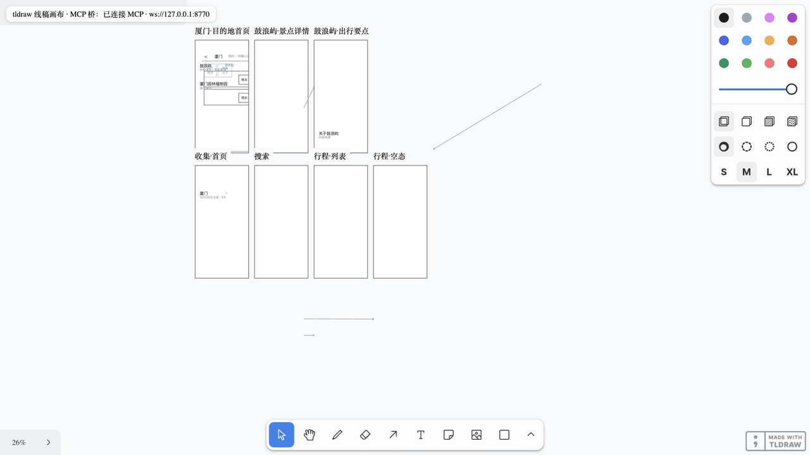
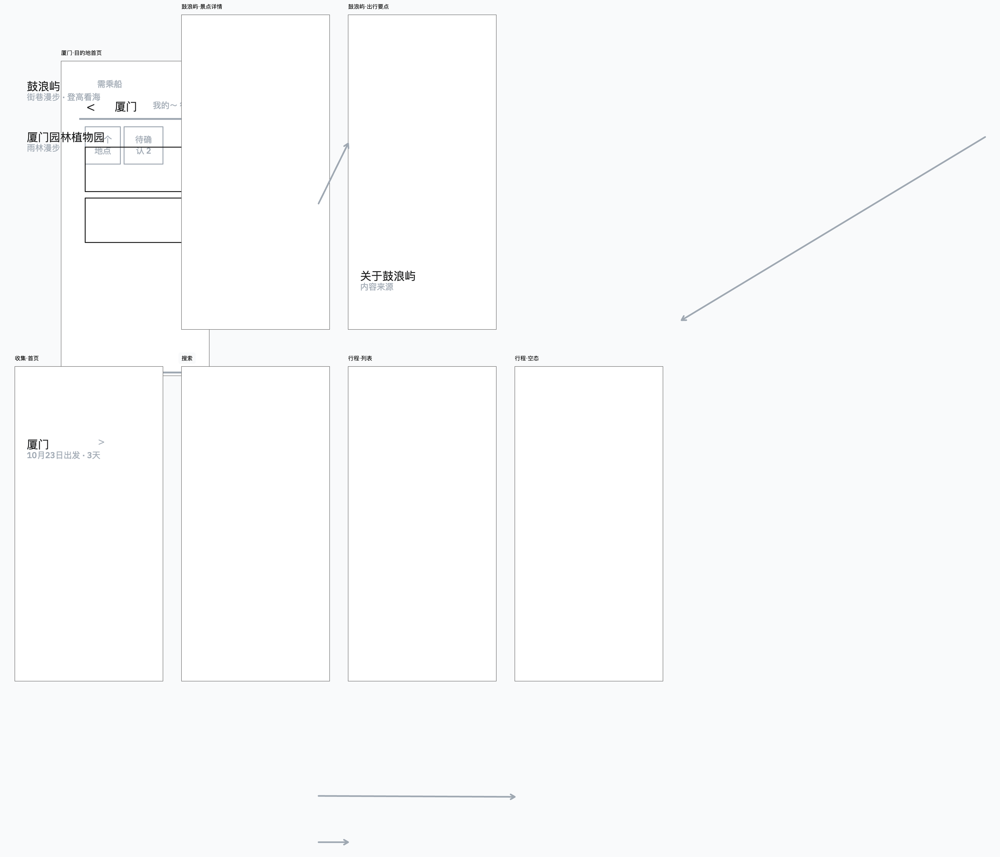

# tldraw-wire-mcp

**让 AI 编码代理直接在你的本地 tldraw 画布上绘制线框原型（wireframe）的 MCP 服务器。**

模型调用一组 `wf_*` MCP 工具，就能在本地浏览器里的真实 tldraw 画布上创建屏幕框、导航栏、按钮、卡片、连线——全程不出本机，不依赖 tldraw.com，产物可存成 JSON 进版本库、可无头导出 SVG、可用 tldraw 原生渲染导出 PNG。



---

## 目录

- [解决什么问题](#解决什么问题)
- [与原版 tldraw 的区别](#与原版-tldraw-的区别)
- [架构：一份 spec，两个渲染器](#架构一份-spec两个渲染器)
- [功能清单](#功能清单)
- [五分钟上手](#五分钟上手)
- [注册为 MCP 服务器](#注册为-mcp-服务器)
- [教程：画你的第一份线稿](#教程画你的第一份线稿)
- [进阶：画布编辑写回与原生导出](#进阶画布编辑写回与原生导出)
- [实现要点与实测坑位](#实现要点与实测坑位)
- [已知限制](#已知限制)

## 解决什么问题

用 AI 做产品原型时，常见的三种做法各有短板：

| 做法 | 短板 |
| --- | --- |
| 让模型输出 HTML/图片 | 不可编辑、不可迭代、无法在画布上继续手工调整 |
| tldraw.com + 官方 MCP 插件 | 官方 MCP App 走 Cursor 插件市场 / ChatGPT 插件分发，ChatGPT 版同步到云端；没有可自托管的独立本地服务 |
| 纯生成 `.tldr` JSON 文件 | 看不见画布、没有实时反馈、导出要另想办法 |

**tldraw-wire-mcp 的思路**：在你的 Mac 上常驻一个「本地画布 + MCP 服务器」，模型通过 stdio 调用绘图工具，画布页面通过 WebSocket 实时呈现；你在旁边看着它画，随时可以上手拖改，改动又会写回服务端数据。人机共用一块画布。

适用场景：产品/交互设计线稿（wireframe）、页面流程草稿、给编码代理描述 UI 结构的「可执行设计稿」。

## 与原版 tldraw 的区别

本项目的画布**就是原版 tldraw SDK**（`npm install tldraw` 渲染的真实编辑器，所有交互能力都在）。区别在于外围怎么用：

| 维度 | 原版 tldraw / 官方 MCP | tldraw-wire-mcp |
| --- | --- | --- |
| 使用方式 | 人在浏览器手工绘制 | **AI 代理经 MCP 程序化绘制**，人可随时接管 |
| 分发/依赖 | 官方 MCP App 仅 Cursor 插件市场、ChatGPT 插件（ChatGPT 版云端同步） | 纯本地：Node + 浏览器，无账号、无云 |
| 数据归属 | tldraw.com 或浏览器 IndexedDB | **JSON spec 是唯一事实源**，可 diff、可提交、可 CI |
| 导出 | 编辑器内手动导出 | 无头 SVG（不需浏览器）+ tldraw 原生 SVG/PNG（画布在线） |
| 语义 | 通用画布（任意形状） | **线稿语义组件**：screen/navbar/tabbar/button/card 等 14 种，模型一次调用画一个「组件」而非拼一堆矩形 |
| 双向同步 | — | 画布手工编辑自动写回 spec（Worker 计时器方案，后台标签不失效） |

一句话：**原版给你一块画布，本项目给 AI 一支画笔，同时保住人的编辑权。**

## 架构：一份 spec，两个渲染器

```
Claude / ZCode / Codex CLI 等 MCP 客户端
        │ stdio (MCP: wf_* 工具)
        ▼
 server/mcp.ts ──持有──▶ WireSpec（JSON，唯一事实源）
        │ WebSocket ws://127.0.0.1:8770（变更全量推送）
        ▼
 画布页（Vite + React + tldraw SDK）
   onMount(editor) → buildShapes() → editor.createShapes() → zoomToFit()
        ▲
        └── 手工编辑写回（Worker 计时器轮询 diff，600ms）

 导出：wf_export_svg   = Node 无头渲染 shared/svg.ts（画布不开也能出图）
       wf_export_native = tldraw 真实渲染（需画布在线，ws 往返取回）
```

服务端 spec 是唯一事实源；tldraw 画布和 SVG 渲染器是同一份 spec 的两个渲染器。所以画布没开也能导图、能进 CI；也正因为如此，你在画布上的拖改才有意义——它会被写回 spec，成为下一次导出的内容。

## 功能清单

**11 个 MCP 工具：**

| 工具 | 作用 |
| --- | --- |
| `wf_draw` | 批量绘制线稿元素，14 种语义组件：`screen`（屏幕框）/ `statusbar` / `navbar` / `tabbar` / `button` / `chip` / `input` / `card` / `list_item` / `section` / `text` / `divider` / `image`（占位图）/ `map`。带稳定 id，重复 id 即替换（增量更新） |
| `wf_connect` | 箭头连接两个元素（标注流程关系） |
| `wf_update` / `wf_delete` / `wf_clear` | 按元素增删改 |
| `wf_list` / `wf_get_item` / `wf_clients` | 屏幕概览 / 单元素查询 / 在线画布数 |
| `wf_save` / `wf_load` | spec 存取 JSON 文件（可 diff、可进版本库） |
| `wf_export_svg` | 无头导出 SVG——不需要画布/浏览器在线 |
| `wf_export_native` | tldraw 原生渲染导出 SVG/PNG（带 tldraw 真实样式，需画布在线） |

**双向同步：**

- spec → 画布：每次变更全量推送，画布重建并自动 `zoomToFit`；
- 画布 → spec：你在画布上拖动/缩放可映射元素（screen 框、card 外框、单形状元素），600ms 内写回服务端。

**容错：**

- ws 端口被其他实例占用时自动降级为纯 stdio（多会话共存不崩）；
- stdio 客户端退出后进程随之退出，不留孤儿进程占端口；
- `WIRE_AUTOLOAD=path.json` 环境变量支持启动即加载线稿。

## 五分钟上手

要求：Node 20+（本项目在 22 实测）、pnpm 或 npm。

```bash
git clone https://github.com/yimeng-tong/tldraw.git
cd tldraw
pnpm install            # 或 npm install

# 终端 1：MCP 服务器（stdio + ws 桥 :8770），启动即加载示例线稿
WIRE_AUTOLOAD=examples/nomad.wire.json pnpm dev:mcp

# 终端 2：画布
pnpm dev                # 打开 http://localhost:5273
```

打开画布后你会看到示例的多屏旅行 App 线稿被自动绘制出来。之后每次在 MCP 客户端里调用 `wf_*`，画布实时更新。

**无浏览器自检**（CI 友好，画布不开也能跑）：

```bash
pnpm smoke              # MCP client → 加载示例 → 导出 SVG → 增量绘制 → 再导出 → 持久化往返
```

**增强链路 e2e**（画布编辑写回 + 原生导出，需按脚本内注释配合浏览器操作）：

```bash
node scripts/verify-enhancements.mjs
```

## 注册为 MCP 服务器

以 ZCode 为例（`~/.zcode/cli/config.json`）；Claude Desktop / Codex CLI 的 `mcpServers` 配置同构：

```json
{
  "mcp": {
    "servers": {
      "tldraw-wire": {
        "command": "/绝对路径/node",
        "args": [
          "/绝对路径/tldraw/node_modules/tsx/dist/cli.mjs",
          "/绝对路径/tldraw/server/mcp.ts"
        ],
        "env": { "PATH": "/绝对路径/node的bin目录:/usr/bin:/bin" }
      }
    }
  }
}
```

注册后新开会话即可直接让模型「用 tldraw 画一个 XX 页面的线稿」。

## 教程：画你的第一份线稿

在任意 MCP 客户端里对模型说：

> 用 tldraw 画一个「登录页」线稿：标题、账号输入框、密码输入框、登录按钮、底部一个「忘记密码 · 注册新账号」链接。画完导出 SVG。

模型会执行类似序列：

```
wf_draw { items: [
  { id: "login",       kind: "screen",  x: 100, y: 100, w: 320, h: 560, label: "登录页" },
  { id: "login-title", kind: "section", x: 130, y: 170, w: 200, h: 30, label: "欢迎回来", screen: "login" },
  { id: "login-user",  kind: "input",   x: 130, y: 230, w: 260, h: 42, label: "账号 / 手机号", screen: "login" },
  { id: "login-pass",  kind: "input",   x: 130, y: 285, w: 260, h: 42, label: "密码", screen: "login" },
  { id: "login-btn",   kind: "button",  x: 130, y: 345, w: 260, h: 46, label: "登录", screen: "login" },
  { id: "login-links", kind: "text",    x: 130, y: 405, w: 260, h: 20, label: "忘记密码 · 注册新账号", screen: "login" },
  { id: "login-div",   kind: "divider", x: 130, y: 450, w: 260, h: 2,  screen: "login" }
]}
wf_export_svg { path: "exports/login.svg" }
```

打开 `http://localhost:5273` 就能看到了。想调整？两种方式：

1. **继续对话**：「把登录按钮改成 320 宽、在密码下面加一个验证码输入框」→ 模型调 `wf_update` / `wf_draw`；
2. **直接上手**：在画布上拖动任何可映射元素 → 600ms 后自动写回 spec，下次 `wf_save` 的 JSON 就是你的调整结果。

**多屏流程**：给每屏一个 `screen`，用 `wf_connect` 标注跳转关系（`from: "login-btn", to: "home-nav", label: "登录成功"`），箭头会出现在画布上。

**保存与复用**：`wf_save { path: "designs/login.wire.json" }` 存进仓库；下次 `wf_load { path: "..." }` 一秒恢复，git 可 diff 每一版设计。

## 进阶：画布编辑写回与原生导出

- **写回机制**：画布页用 Web Worker 计时器（600ms）轮询形状快照做 diff。之所以不用事件监听：tldraw 的 `store.listen` 回调依赖 rAF，浏览器标签页在后台时永不触发；普通 `setInterval` 也会被深度节流。Worker 计时器不受页面可见性影响。
- **原生导出**：`wf_export_native { format: "png", path: "out.png" }` 会通过 ws 让画布调用 `editor.getSvgString()` / `editor.toImage()` 渲染后传回。画布离线时工具会明确报错并建议改用无头的 `wf_export_svg`。

示例：`examples/nomad.wire.json` 是一份旅行 App 的 6 屏线稿（目的地列表 / 景点详情 / 景点与出行要点 / 收集 / 搜索 / 行程列表），由「OCR 提取 → 视觉模型校准 → MCP 绘制」流程产出（提取与校准依据见 `refs/`）。tldraw 原生渲染导出效果：



## 实现要点与实测坑位

自建同类服务时这些坑值得先知道（均为实测结论，测试时安装的 tldraw v3.x）：

| 坑 | 结论 |
| --- | --- |
| frame 命名 | 名字在 `props.name`，放形状顶层会校验崩溃 |
| `geo` 形状 | 没有 `'line'` 值（老教程常见）；分隔线用 2px 细矩形 |
| 箭头端点 | `props.start/end` 是纯 `{x, y}` 页面坐标，binding 形态经 `createShapes` 传入会校验失败 |
| 富文本 | 文字一律 `props.richText = toRichText('...')`，旧的 `props.text` 运行时报错 |
| 批量操作 | 用 `editor.run()`（旧名 `batch()` 已改） |
| 稳定 id | 必须 `createShapeId('xxx')`，字面量 id 抛错 |
| 导出 API | `getSvgString()` 返回 `{svg}` 包装对象且为 async；`toImage()` 返回 `{blob,width,height}`，PNG 需自行转 dataURL；`exportToBlob`/`editor.getSvg` 已移除 |
| 后台标签 | `store.listen` 依赖 rAF（后台不触发）、`setInterval` 被深度节流——需要后台可靠的定时行为时用 Web Worker 计时器 |
| 多实例 | 先到者得 ws 端口；后来者应降级而非崩溃（本项目已实现） |

## 已知限制

- **箭头不跟随**：受上面端点限制，移动形状后连线不跟随（后续可实验该版本的 binding API）；
- 无头 SVG 是自研简化渲染器（线框风格）；要 tldraw 真实样式用 `wf_export_native`（需画布在线）；
- 多文本组合元素（navbar/tabbar/list_item）的位置暂不写回；
- 画布页暴露 `window.__wireEditor` 调试钩子（e2e 与脚本验证用）；
- tldraw SDK 为 source-available 许可：免费使用画布带 "Made with tldraw" 水印，内部线稿场景无碍，商业去水印需向 tldraw 购买许可；本项目自身代码 MIT（见 LICENSE）。

## 项目结构

```
server/mcp.ts        MCP 服务器（stdio）+ ws 桥 + spec 持有者
shared/spec.ts       WireSpec 数据模型（两端共享，无运行时依赖）
shared/svg.ts        无头 SVG 渲染器（Node 可跑）
src/App.tsx          画布页（tldraw + ws 客户端 + 写回轮询）
src/shapes.ts        WireSpec → tldraw 形状构建器
examples/            示例线稿（旅行 App 6 屏）
scripts/             smoke / verify-enhancements / load-example
refs/                示例线稿的提取与校准依据（OCR + 视觉描述）
```

## License

本项目代码以 MIT 发布（见 LICENSE）。画布渲染依赖的 [tldraw](https://github.com/tldraw/tldraw) SDK 遵循其自身 source-available 许可。
